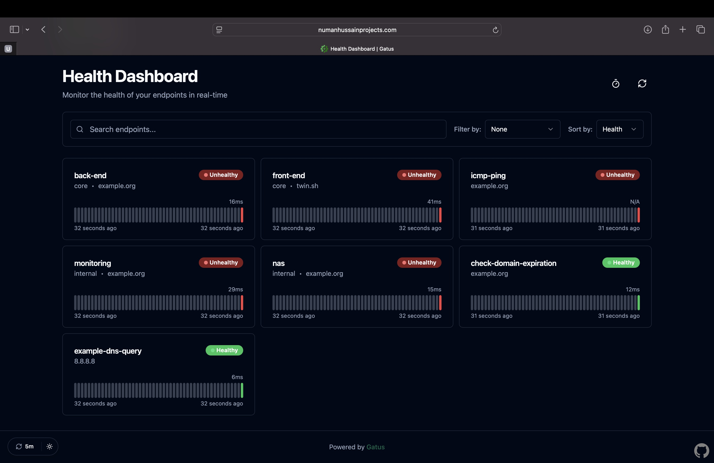
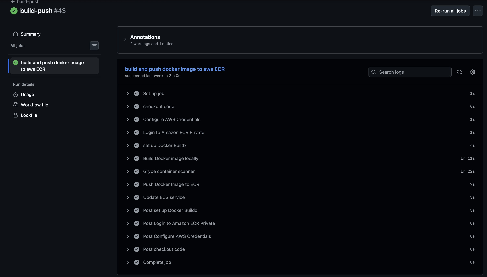
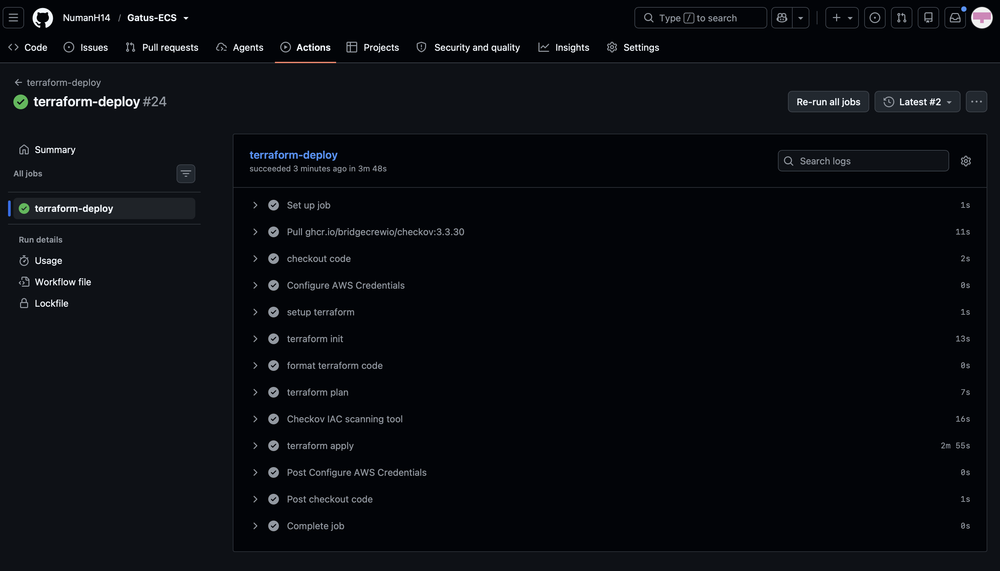
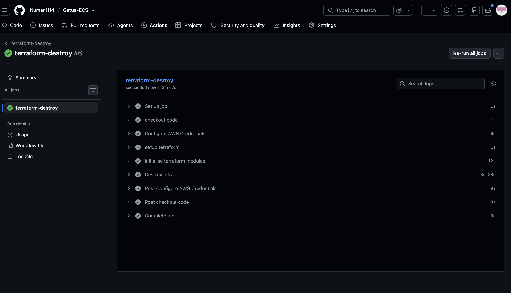

# Production-Grade Gatus on AWS ECS

## Technology Stack


</img>

## Overview

This project deploys Gatus, an open-source uptime and health monitoring application, hosted on AWS ECS Fargate. The infrastructure is provisioned using modularised Terraform, with secure, manually triggered CI/CD pipelines built using GitHub Actions to automate the build and deployment process.

The aim is to go beyond simply deploying an application and demonstrate how to build a reliable and secure cloud environment, with a focus on networking, maintainability, and practices that reflect real-world DevOps workflows.

## Key Features

- **Compute**: ECS with Fargate (no servers to manage)
- **Networking**:
  - VPC across **2 Availability Zones**
  - Public subnets for ALB
  - Private subnets for ECS tasks
  - NAT Gateway for controlled outbound access for private subnets
  - Internet Gateway for bi-directional traffic 
  - **State & DNS**:
  - Terraform remote state in S3 with native locking
  - Hosted on Cloudflare
  - **Security**:
  - HTTPS via Amazon Certificate Manager
  - IAM roles with least privilege
  - Security groups with strict control
- **CI/CD**:
  - GitHub Actions with OIDC (no long-lived AWS keys)

  -**Container build**: For the application i containerised it using docker & golang
  - Implemented multi-stage build to reduce image size by 95%
  - Using scratch as the base image to make image small as possible
  - Non-root user to reduce surface area of attack and to improve it's security posture
  - Docker images scanned using container security scanner tool grype which identifies vulnerbilities before being pushed.

### Infrastructure as Code (Terraform)

- Fully modular structure:
  - VPC
  - ALB
  - ECS
  - ECR
  - ACM
  - Cloudflare
- Remote Terraform state stored in Amazon S3
- Variables and reusable modules follow **DRY (Don't Repeat Yourself)** principles

- Enables consistent and repeatable deployments
- Simplifies collaboration and environment management
- Supports controlled teardown and reproducible rebuilds
- Eliminates undocumented manual configuration

### Security and networking

- ECS tasks run exclusively in private subnets with no public IP addresses
- NAT Gateway provides outbound internet connectivity
- ALB security group restricts inbound traffic to ports 80 and 443
- ECS security group allows inbound traffic only from the ALB security group
- HTTPS is configured using ACM
- IAM roles follow the principle of least privilege
- **Grype** scans container images for vulnerabilities
- **Checkov** scans Terraform configurations for security issues
- GitHub Actions authenticates with AWS using OIDC instead of long-lived access keys

### Application Load Balancer

- Multi-AZ ALB deployment for high availability
- HTTP → HTTPS redirection
- Distributes traffic across healthy targets
- Enforces encrypted connections using ACM-managed certificates
- Separates external traffic management from application compute

 ### ECS on Fargate

- ECS tasks run **exclusively in private subnets**
- No public IP addresses are assigned to ECS tasks
- The ALB is the only internet-facing component

- Reduces the attack surface and limits the blast radius
- Prevents direct public access to application containers
- Follows real-world enterprise security practices

### CI/CD pipelines (GitHub Actions)

Three **manually triggered** pipelines:

1. **Docker build & push**
   - Builds the Docker image
   - Scans the image for vulnerabilities using Grype
   - Pushes the image to ECR only if it passes the configured security checks

2. **Terraform apply**
   - Runs `fmt`, `validate` and `plan`
   - Performs Checkov security scanning (**soft fail**)
   - Provisions infrastructure using Terraform

3. **Terraform destroy**
   - Tears down the managed infrastructure

All pipelines use **OIDC** to assume an AWS IAM role, eliminating the need for long-lived AWS access keys.

- Prevents unintended deployments and infrastructure deletion
- Integrates security checks directly into CI/CD workflows
- Uses short-lived AWS credentials through OIDC
- Provides controlled infrastructure changes

## Repository structure
```
gatus-ecs/
│
├── .github/
│   └── workflows/
│       ├── build-and-push.yml
│       ├── terraform-deploy.yml
│       └── terraform-destroy.yml
│
├── app/
│   ├── Dockerfile
│   └── .dockerignore
│
├── bootstrap/
│   ├── main.tf
│   ├── provider.tf
│   ├── variables.tf
│   ├── outputs.tf
│   └── policies/
│       └── ...
│
├── infra/
│   ├── main.tf
│   ├── provider.tf
│   ├── variables.tf
│   ├── backend.tf
│   │
│   └── modules/
│       ├── acm/
│       ├── alb/
│       ├── ecr/
│       ├── ecs/
│       ├── cloudflare/
│       └── vpc/
│
├── .gitignore
│
└── README.md
```

## Local Development

**prerequisite**

-Docker must be installed.

```
git clone https://github.com/NumanH14/gatus-ecs.git
cd app
docker build -t gatus .
docker run -p 8080 -d gatus:latest


Then visit `http://localhost:8080`
```

## Screenshots
Screenshot of the Gatus app deployed on the web browser:
</img>

Screenshot of successful build-push pipeline:
</img>

Screenshot of successful terraform deploy pipeline:
</img>

Screenshot of successful terraform destroy pipeline:
</img>

---

## What is Gatus?

Gatus is an open-source monitoring tool that checks whether websites, APIs and other services are working as expected.

It runs regular checks on configured services and displays their status on a dashboard. If a service goes down or fails a check, Gatus can detect it and send alerts.

It gives DevOps and infrastructure teams a straightforward way to monitor their services and spot issues before they become bigger problems.

## Why did you choose Gatus?

I chose Gatus because it has a practical use case in real-world environments. Monitoring service availability is an important part of maintaining reliable infrastructure, and Gatus provides a simple way to do that.

It also gave me an application to work with while building and deploying the AWS infrastructure around it.

## Why host it on ECS Fargate?

I chose ECS Fargate because I wanted to deploy Gatus as a container without having to manage the underlying servers.

I could have hosted it on an EC2 instance, but Fargate allowed me to focus on the container deployment, networking, security and other AWS services rather than managing the operating system and servers.

I also wanted to build the infrastructure using Terraform instead of relying on a managed hosting service that handles most of it behind the scenes. This gave me hands-on experience provisioning and managing AWS resources as code, including the VPC, subnets, load balancer, ECS service and supporting infrastructure.

## How many users are there, or how many are you expecting?

I'm not expecting many users because the main purpose of this project is to demonstrate my Cloud and DevOps skills rather than run a service for a large number of people.

In a real-world environment, I would expect the main users to be DevOps, development and infrastructure teams using the dashboard to monitor the health of their services.
